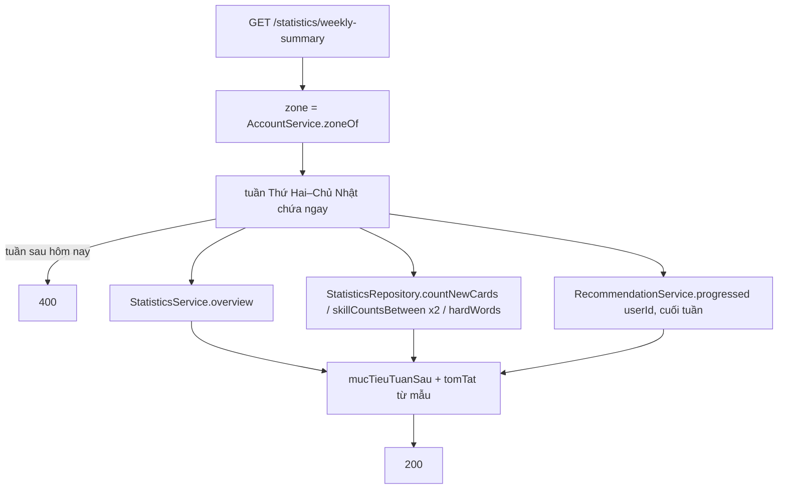

# B3.9 — Tổng kết tuần (FR-11, gọn)

Trạng thái 16/11/2026: code xong, `FR11WeeklySummaryTest` 2/2 pass, toàn bộ `mvnw test` 542/542 pass; đã gọi HTTP thật trên dev (16/11/2026), chưa Postman; mockup UI37 đã đọc route demo đúng DTO. Không có migration. Bản đồ làm chủ UI36 dùng `GET /statistics/skills` có sẵn (B2.10); lưới màu từng từ đã cắt.

## 1. API

`GET /api/v1/statistics/weekly-summary?ngay=YYYY-MM-DD` — đăng nhập, cần gói (như các API `/statistics/**`).

- `ngay` tùy chọn, là **một ngày bất kỳ** trong tuần cần xem; mặc định hôm nay. Tuần = Thứ Hai → Chủ Nhật theo múi giờ hồ sơ người học.
- 400 `fieldErrors[].field = ngay`: sai định dạng, ngày không tồn tại, tuần bắt đầu sau hôm nay. 401 chưa đăng nhập.

| Trường | Ý nghĩa / nguồn |
|---|---|
| `muiGio`, `tuNgay`, `denNgay`, `tuanHienTai` | Tuần đã chọn; `tuanHienTai = true` khi hôm nay thuộc tuần |
| `soTuDaHoc`, `soLuotOn`, `tyLeNho`, `tongPhut`, `soNgayCoHoc` | Gọi `StatisticsService.overview(tuNgay, min(denNgay, hôm nay))`, cùng cách tính với trang thống kê (FR-11) |
| `soTuMoi` | Số thẻ có lượt ôn **đầu tiên** rơi vào tuần |
| `soCauLuyen` | Tổng câu của các lượt nộp bài trong tuần |
| `kyNang[]` | 5 kỹ năng `{kyNang, soQuanSat, tyLeDung, soQuanSatTuanTruoc, tyLeDungTuanTruoc, duDuLieu, tienBo}`: câu luyện tuần này so với tuần trước; `duDuLieu` khi cả hai tuần ≥ `app.statistics.so-quan-sat-toi-thieu` (5) câu; `tienBo = duDuLieu && tyLeDung > tyLeDungTuanTruoc` |
| `tuKho[]` | Tối đa 3 `{theId, tu, boTheId, tenBo, soLanSai, soLuot}`: sai = lượt ôn `QUEN` + câu luyện `dung = false` trong tuần; chỉ thẻ chưa xóa của bộ chưa xóa thuộc người học; xếp theo `soLanSai`, `soLuot` giảm dần |
| `tuDaVuotQua[]` | R-04: cùng quy tắc `TIEN_BO` của B3.5 (`ProgressRule`) với mốc `now = cuối tuần`, nên cửa sổ "mới" là đúng tuần đó và cửa sổ "cũ" là 23 ngày trước tuần. Dạng giống `/learning/recommendations`: `{reasonCode: TIEN_BO, message, cardIds, evidence}` |
| `mucTieuTuanSau` | `{soNgayHoc, phutMoiNgay, theIds, vanBan}`: `soNgayHoc = min(7, max(3, soNgayCoHoc + 1))`, `phutMoiNgay` từ cài đặt học, `theIds` = các từ khó |
| `tomTat` | Câu dựng từ mẫu (không gọi AI), chỉ dùng số liệu trên |

## 2. Luồng

Ranh giới tuần tính bằng `LocalDate.atStartOfDay(zone)` nên đúng cả khi đổi múi giờ (lấy múi giờ hiện tại của hồ sơ, giống `overview`).

## 3. Sửa kèm ở B3.5

`SoTayTuKhoRepository.progressStats` trước đây chỉ có cận dưới; thêm tham số `den` (cận trên, loại trừ). `ProgressRule` truyền `now` nên gợi ý hiện tại không đổi hành vi; tổng kết tuần cũ không còn đếm các lượt sau cuối tuần. `RecommendationService.progressed(userId, until)` trả các gợi ý `TIEN_BO` (tối đa `toiDaGoiY`).

## 4. Kiểm chứng

`FR11WeeklySummaryTest` (16/11/2026, Testcontainers, dùng tuần trước so với ngày thật): 3 thẻ đã ôn, 2 thẻ mới, 11 lượt, 6 câu luyện, 3 ngày học; `VIET` 40 % → 83 % `tienBo`; từ khó `appointment` 4/5 sai; `receipt` vượt qua (sai 3/5 trước, đúng 5/5 trong tuần) dù có một lượt `QUEN` ngay sau cuối tuần; mục tiêu 4 ngày, có tên từ khó; người khác → số 0 và "chưa có lượt học nào"; mặc định tuần hiện tại; 400 tuần tương lai, ngày không tồn tại, sai định dạng; 401. Chạy kèm `RecommendationRulesTest`, `FR08RecommendationTest`, `FR11StatisticsTest`: 15/15 pass.

## 5. Giới hạn

- Kỹ năng chỉ tính từ bài luyện (như `/statistics/skills`), không tính lượt ôn.
- `soTuMoi` dựa trên lượt ôn đầu tiên; thẻ chỉ làm trong bài luyện không tính là từ mới.
- `tuDaVuotQua` bỏ thẻ đang `TAM_NGUNG` hoặc đã xóa (cùng bộ lọc với B3.5).
