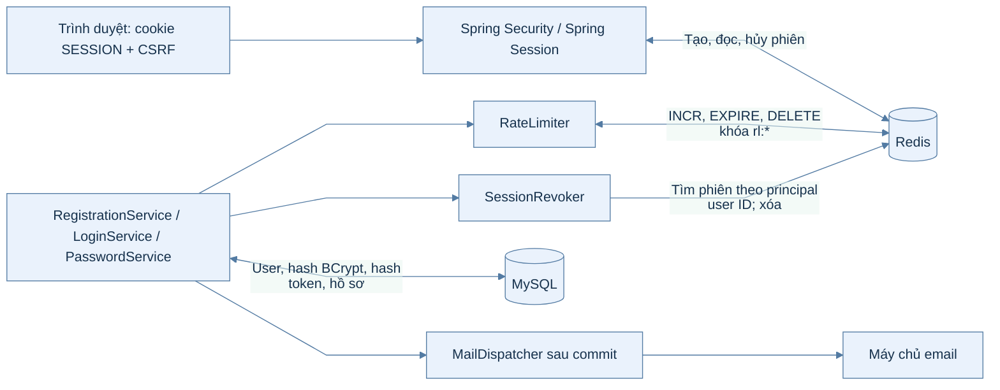
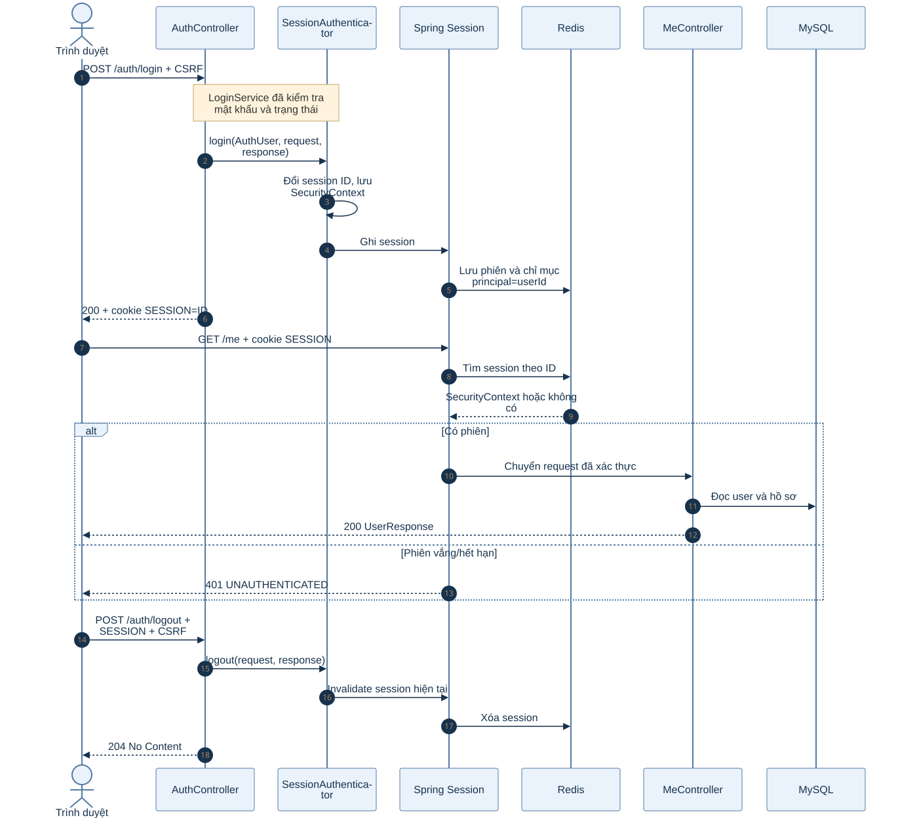
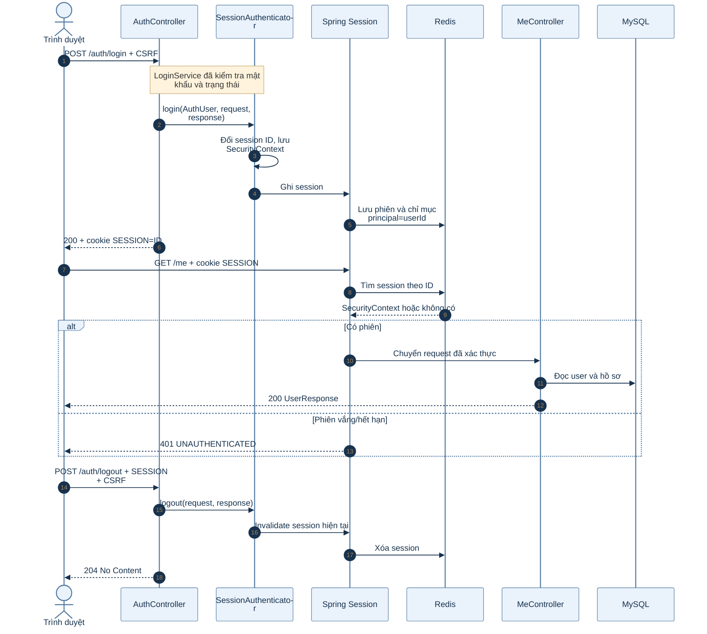
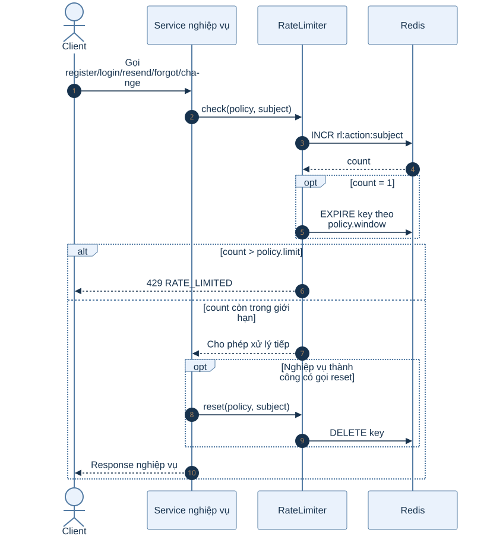
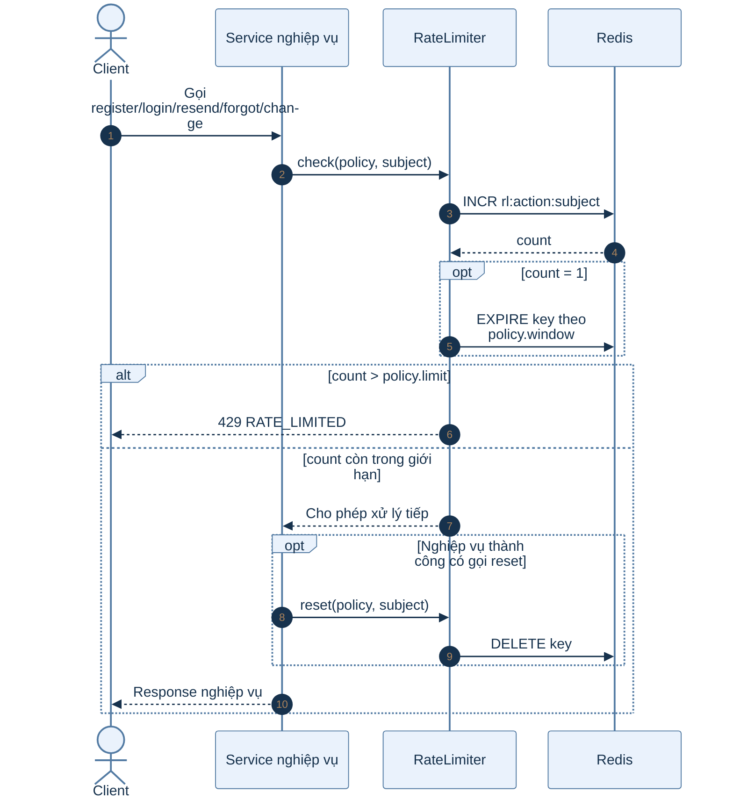
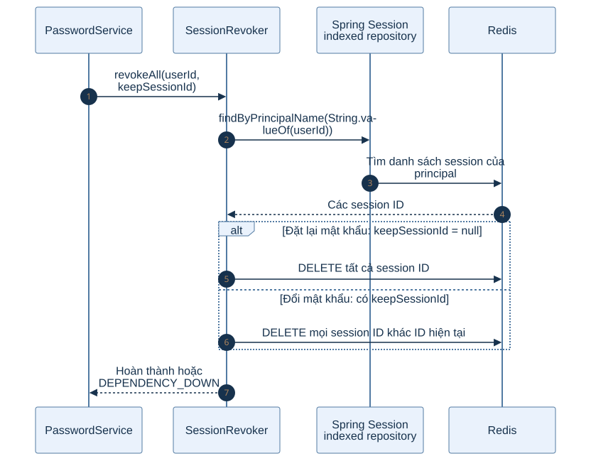
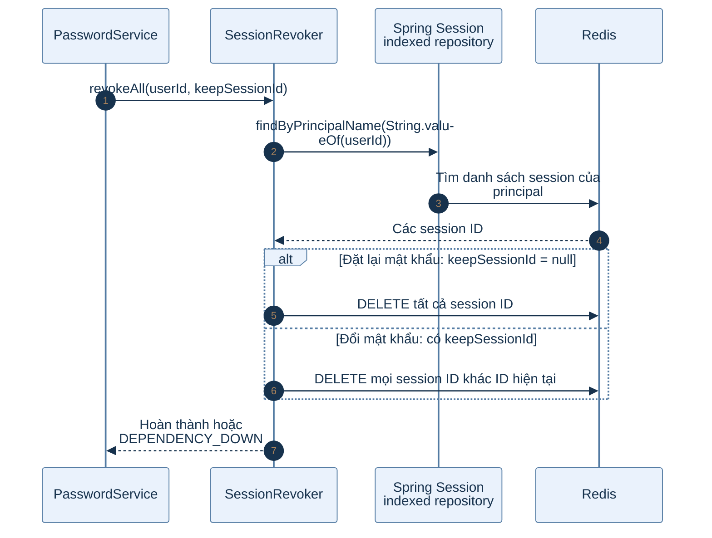

# Luồng Redis trong dự án VocabLearning

Tài liệu này giải thích vai trò Redis **đã được triển khai** ở nền tảng backend và B1.1–B1.3. Những ý tưởng Redis của các bước roadmap sau không được xem là chức năng hiện tại.

## 1. Sơ đồ vai trò Redis

Redis ở phạm vi này có **ba nhóm dữ liệu thực tế**: phiên Spring Session, bộ đếm `RateLimiter` và snapshot xem trước CSV của B1.12 (`CsvImportSnapshotStore`, TTL 30 phút; chi tiết ở `B1.12`). `SessionRevoker` thao tác trên nhóm phiên; nó không tạo kho dữ liệu thứ tư. Phần giải thích bên dưới tập trung vào hai nhóm đầu.

Xem mã Mermaid của sơ đồ

**Đọc sơ đồ:** Cookie `SESSION` chỉ chứa mã tham chiếu; Redis giữ nội dung phiên. Redis không quyết định mật khẩu đúng hay token email còn hạn: các dữ liệu đó được kiểm tra từ MySQL. Cookie `XSRF-TOKEN` và header `X-XSRF-TOKEN` thuộc cơ chế CSRF riêng.

## 2. Sơ đồ tuần tự: tạo, sử dụng và hủy phiên

Xem mã Mermaid của sơ đồ

### Phân tích từng bước phiên

1. `SecurityConfig` cấu hình `CookieSerializer` đặt tên cookie là `SESSION`, `HttpOnly`, `SameSite=Lax`; `Secure` theo `app.cookie-secure`. `application.yaml` đặt `server.servlet.session.timeout: 7d` và `repository-type: indexed`.
2. Chỉ sau khi `LoginService` xác thực email/mật khẩu và trạng thái user, `SessionAuthenticator` mới tạo `Authentication`. Nó đổi session ID chống session fixation và lưu `SecurityContext` vào session.
3. Spring Session ghi session vào Redis. Vì repository là `indexed`, có thể tìm các session theo principal. `AuthUser.getName()` trả chuỗi user ID, nên `SessionRevoker` có thể tìm phiên của một user bằng ID đó.
4. Ở request `GET /me`, cookie cung cấp session ID; Spring Session đọc Redis để khôi phục SecurityContext. Sau bước này `AccountService` vẫn đọc MySQL để trả dữ liệu user/hồ sơ mới nhất. Redis không thay MySQL làm nguồn dữ liệu hồ sơ.
5. Khi logout, `SecurityContextLogoutHandler` hủy session. Redis mất dữ liệu phiên; cookie cũ không còn khôi phục được principal, nên `/me` trả `401`.

## 3. Sơ đồ tuần tự: giới hạn tần suất

Xem mã Mermaid của sơ đồ

### Phân tích từng bước bộ đếm

1. Mỗi chính sách xác định `action`, `limit`, `window`. Khóa có dạng `rl:<action>:<subject>`. Ví dụ đăng nhập dùng `rl:login:email:<SHA-256(email)>`; đổi mật khẩu dùng `rl:change-password:user:<id>`.
2. `INCR` tăng số đếm cho **mỗi lần gọi `check`**, kể cả lần sau đó thất bại ở MySQL hoặc sai mật khẩu. Nếu số đếm vừa thành 1, backend gọi `EXPIRE` để khóa tự hết hạn khi kết thúc cửa sổ.
3. `count > limit` mới bị từ chối. Vì vậy giới hạn 5 cho phép các lần 1–5 và chặn từ lần 6 trong cùng cửa sổ. Đây là cửa sổ cố định tính từ lần đầu tạo khóa, không phải cửa sổ trượt.
4. Một số thao tác gọi hai lần `check`: gửi lại email và quên mật khẩu kiểm tra IP rồi đến hash email. Nếu khóa thứ hai vượt giới hạn, lần kiểm tra thứ nhất vẫn đã được tăng đếm.
5. `reset` xóa khóa ở các tình huống được mã nguồn quy định: đăng nhập thành công, đặt lại mật khẩu xóa giới hạn login, đổi mật khẩu thành công xóa giới hạn change-password. Đăng ký, gửi lại email và quên mật khẩu tự hết hạn theo TTL.

| Policy | Subject thực tế | Giới hạn | Khi nào xóa sớm? |
| --- | --- | --- | --- |
| `REGISTER` | IP | 5 lần/1 giờ | Không; chờ TTL. |
| `RESEND_EMAIL` | `ip:<IP>` và `email:<SHA-256(email)>` | 3 lần/15 phút cho từng khóa | Không; chờ TTL. |
| `LOGIN` | `email:<SHA-256(email)>` | 5 lần/15 phút | Login thành công hoặc reset mật khẩu. |
| `FORGOT_PASSWORD` | `ip:<IP>` và `email:<SHA-256(email)>` | 3 lần/15 phút cho từng khóa | Không; chờ TTL. |
| `CHANGE_PASSWORD` | `user:<id>` | 5 lần/15 phút | Đổi mật khẩu thành công. |
| `file-upload` (khai trong `FileService`) | `rl:file-upload:<userId>` | 30 lần/phút | Không; chờ TTL. |

## 4. Sơ đồ tuần tự: thu hồi phiên khi mật khẩu thay đổi

Xem mã Mermaid của sơ đồ

### Phân tích thu hồi

1. `SessionRevoker` dùng chỉ mục principal của Spring Session để lấy tập session ID; nó không tìm thủ công toàn bộ khóa Redis.
2. `resetPassword` truyền `null`, nên bộ lọc giữ lại không khớp session nào: **mọi phiên** bị xóa.
3. `changePassword` truyền ID phiên lấy từ request. Bộ lọc bỏ qua ID này, chỉ xóa các phiên ở thiết bị/trình duyệt khác.
4. Nếu thao tác Redis ném `DataAccessException`, `SessionRevoker` trả `503 DEPENDENCY_DOWN`. Không nên báo đổi mật khẩu thành công khi API trả lỗi này. Giao dịch MySQL và thao tác Redis không phải một giao dịch phân tán duy nhất; tài liệu không giả định chúng commit nguyên tử với nhau.

## 5. Redis làm gì và không làm gì?

| Dữ liệu/cơ chế | Nơi thực tế | Lý do |
| --- | --- | --- |
| Phiên đăng nhập, SecurityContext, chỉ mục principal | Redis qua Spring Session | Nhiều request dùng cùng phiên; có thể xóa phiên khi logout hoặc thay mật khẩu. |
| Bộ đếm giới hạn và TTL | Redis qua `StringRedisTemplate` | `INCR` nhanh, khóa tự hết hạn. |
| User, vai trò, hồ sơ, hash BCrypt | MySQL | Dữ liệu tài khoản bền vững, nguồn sự thật của nghiệp vụ. |
| Hash token xác thực/reset, loại, hạn, `da_dung_at` | MySQL `token_tai_khoan` | Token dùng một lần được kiểm tra và cập nhật có điều kiện. |
| Token gốc trong liên kết | Email gửi cho người dùng | Không lưu token gốc trong Redis/MySQL. |
| CSRF | Cookie `XSRF-TOKEN` + header `X-XSRF-TOKEN` | Chống giả mạo POST/PUT; khác cookie phiên `SESSION`. |

### Khi Redis gặp sự cố

`RateLimiter` và `SessionRevoker` bắt lỗi truy cập Redis và trả `503 DEPENDENCY_DOWN`; chúng không âm thầm bỏ qua giới hạn hoặc yêu cầu thu hồi phiên. Các API cần phiên còn phụ thuộc Spring Session có đọc được Redis hay không. Không nên nhầm lỗi hạ tầng này với `401` do không có phiên hoặc `429` do vượt giới hạn.

**Mã nguồn/cấu hình chính:** `backend/k28/src/main/resources/application.yaml`; `common/security/RateLimiter.java`, `SessionRevoker.java`, `SessionAuthenticator.java`, `SecurityConfig.java`; `account/service/TokenService.java` dưới `backend/k28/src/main/java/com/do_an_tot_nghiep/k28/`.
